# Lightsmith Studio

A GUI for setting up, running and analysing photonics simulations with the
Lightsmith library (repository `lightsmith`, expected next to this one). It does everything the library does, and nothing it can't:
- every form is generated from the library's JSON Schema;
- every action is a JSON edit to the same spec the `lightsmith` CLI reads.

The same build runs in three ways:
- in a browser;
- in a Docker image for the hosted service;
- as a desktop app wrapped with Tauri.

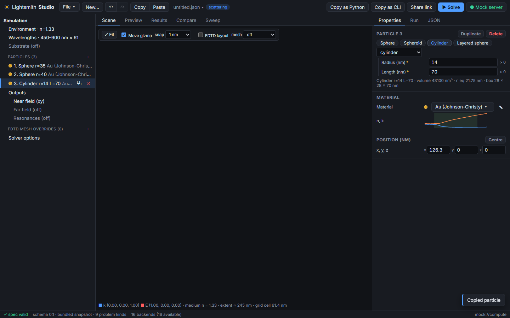

The product name, app name, deep-link scheme and the library's package/CLI names live in one file:
[`src/config/brand.ts`](src/config/brand.ts).

## Problem kinds

**New…** opens the project picker. The list of kinds comes from the live schema, so a kind added to
the library appears automatically, with generated editors. Every kind has the same five center tabs:
**Scene** (the editor below), **Preview** (what the chosen backend will discretise), **Results**, **Compare**
(several backends or runs, with their differences) and **Sweep** (one parameter over a range).

| Kind | Scene editor | Result viewer |
|---|---|---|
| `scattering` | 3D viewport: particles to scale, move gizmo, substrate, k/E arrows, near-field plane; FDTD layout (TFSF box, flux boxes, CPML, mirror planes, mesh overrides, Gaussian-beam focus and waist) and mesh slice | spectra (C or Q; ext/sca/abs), compare, near-field heatmap, far-field polar/3D, resonance (Q) table |
| `layer_stack` | layer stack editor: add from presets, reorder, remove; superstrate and substrate; n at mid-band | R/T/A vs λ per angle and polarization, R/T/A vs angle map |
| `periodic` | patterned-layer stack, plus a 2D unit-cell editor with neighbouring cells shown | R/T/A plus diffraction-order efficiencies |
| `mode` | 2D cross-section editor: drag structures, simulation window | n_eff/n_g/loss/TE-fraction/A_eff table, n_eff(λ), field heatmaps (\|E\|², \|H\|², components) with outlines |
| `device` | top view: structures (prism/box/ball footprints), ports with direction, domain; solver chips (EME, BPM, FDFD, FDTD) and te/tm for 2D devices | \|S\|² in dB or linear, unwrapped phase, \|S\| matrix vs λ, power-balance check |
| `bands` | unit-cell editor with lattice vectors and tiled neighbours; 3D crystals shown in top view | band diagram with k labels, gaps shaded per polarization and complete gaps, gap table (a/λ and nm) |
| `circuit` | netlist graph: instances, connections, external ports | S-parameters, as for devices |
| `optimization` | the device top view plus hatched design regions | objective and binarization history, S-parameters of the final design |
| `emission` | the 3D viewport: particles, and the dipole with its moment (move gizmo); FDTD layout and mesh slice | Purcell factor, radiative and non-radiative decay vs λ (linear or log), quantum efficiency, radiation-pattern polar cuts |

- **Starting points.** Every kind has an *Example*, which the library solved when the snapshot was
  taken (`scripts/make_fixtures.py`), and a *Blank* start from schema defaults. Scattering also has
  eight templates (sphere, dimer, core–shell, rod, spheroid, trimer, Si sphere, sphere on glass) and four
  FDTD set-ups that the library has laid out and solved: a dimer gap with a mesh override and two mirror
  planes, a graded-grid plasmon ring-down with its resonances, a focused Gaussian beam, and a sphere on glass
  at 45°. Devices also start from *FDTD: 2D waveguide, TE ports*, solved by the FDTD device solver.
- **Editing in the scene.** Clicking an object in the scene selects it in the object tree. Its
  Properties panel shows the generated form, with the material picker for every material field.
  Drags are undoable spec ops.
- **Materials.** The picker draws on the bundled library, the materials-db service, models
  (constant n or ε, Drude, Drude–Lorentz) and CSV import, with n/k previews.
- **Running.**
  - The Run panel lists each backend's verdict, using the library's own reasons from
    `POST /v1/supports`.
  - Device choice and per-backend option forms come from each backend's `options_schema`.
  - Estimate gives memory and runtime before you run.
  - Solve and Compare send jobs with live progress over WebSocket; you can cancel and re-run.
  - Parameter sweep (in the Run panel) submits one solve per value; see "Every solver" below.
- **Files and sharing.** Open and save spec JSON (recent files, drag and drop). Deep links take the
  form `?spec=`, `?spec_url=` and `lightsmith-studio://open?spec=`. "Copy as Python / CLI / curl /
  MCP" is available, and `window.studio` scripting with a live JSON panel.

## Every solver: preview, compare, sweep

Studio is the GUI for the whole suite: Mie, T-matrix, DDA, BEM, quasistatic, FDTD, RCWA, TMM, FDE, FDFD, EME,
BPM, PWE, circuits and inverse design. The Run panel lists every backend for the problem kind with the
library's verdict, and the scene editors of the 2D kinds have chips to pick one.

**Preview** shows what the chosen backend will discretise, before the run, as the library plans it:

| Backend | Preview |
|---|---|
| Mie (`lightsmith-mie`) | multipole order n_max per wavelength, with the size parameter |
| T-matrix (`treams`) | lmax per particle (more for close neighbours), modes |
| DDA | the occupied dipole lattice in 3D, coloured by material; spacing, dipoles per diameter |
| BEM | the surface mesh in 3D; triangles, edges, unknowns |
| FDTD | scattering and emission: cell widths per axis (the Scene tab draws the boxes, CPML, mirror planes and mesh slice); devices: the grid with PML, port source and monitor planes, te/tm |
| RCWA | the Fourier orders (m, n) and the layers, each uniform in z |
| FDE | the cross-section grid, PML, boundary, structure outlines |
| FDFD | the device grid, PML and ports |
| EME | the cells along the propagation axis and the modes per cell |
| BPM | the cells and the propagation steps per cell |
| PWE | the k-path in reduced coordinates and the plane-wave set per polarisation |
| inverse design | the FDFD grid, the design regions and their filter radius in cells |
| TMM, quasistatic, circuits | nothing to discretise: the estimate's figures |

| | |
|---|---|
| 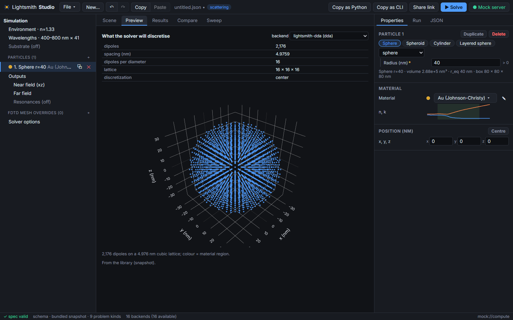 | 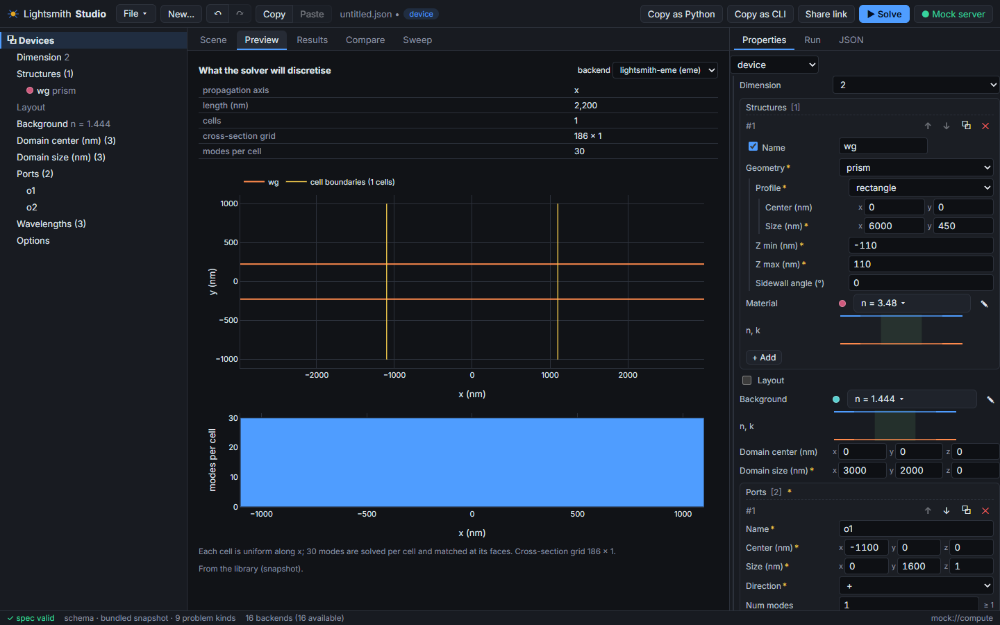 |
| 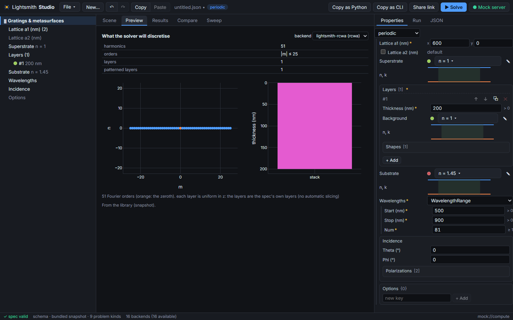 | 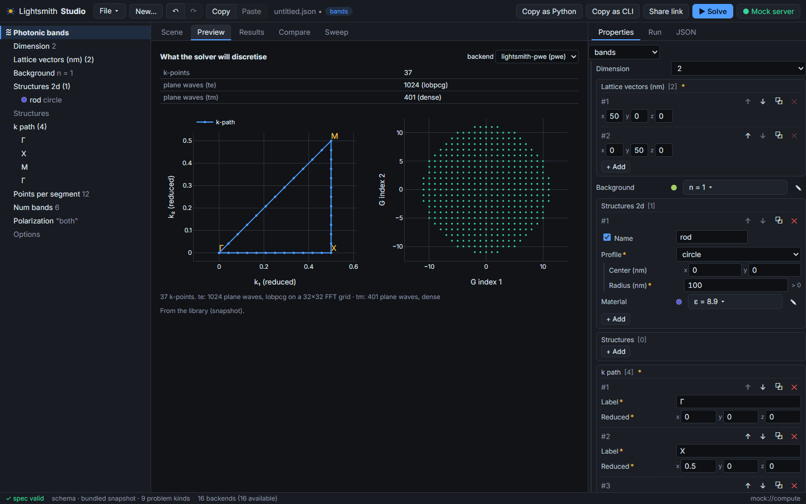 |
| 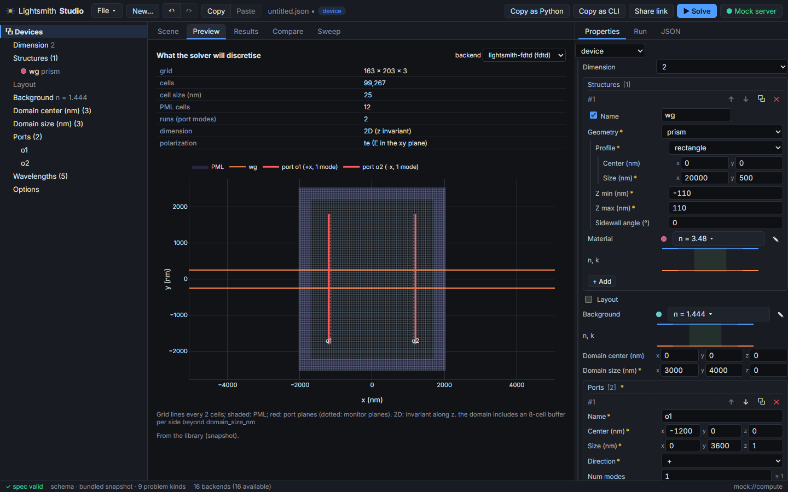 | 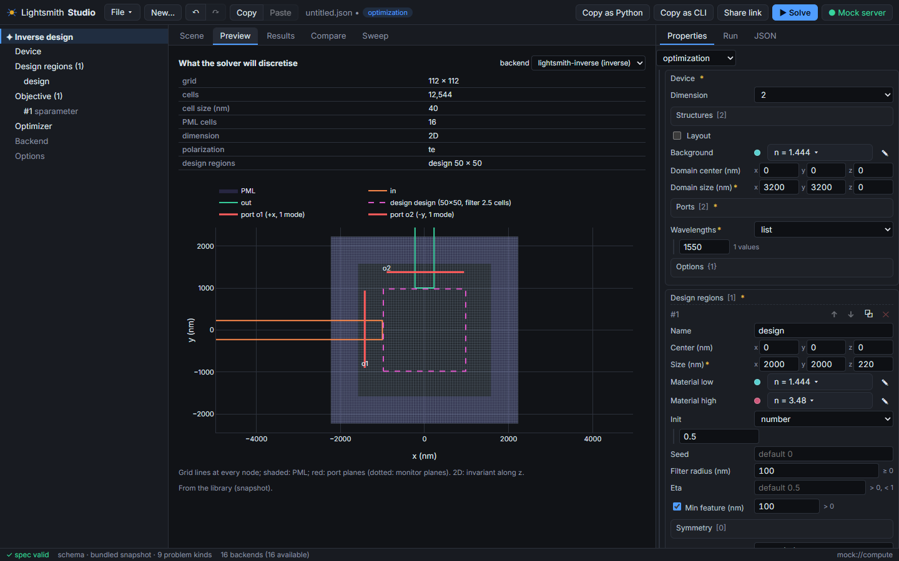 |

The layout comes from the server's proposed `POST /v1/layout`, else (development) the dev server's library
bridge running `scripts/solver_layout.py`, else the estimate's figures; the mock serves the library's layouts
of the shipped examples. See API_ASSUMPTIONS.md, "Proposed: solver layouts".

**Compare** works for every problem kind. Tick backends under *Compare* in the Run panel (or tick finished runs
in Results) and the Compare tab overlays one quantity across them (cross sections, R/T/A per polarisation and
angle, n_eff and n_g per mode, \|S\|² per port pair, bands, decay rates, the objective history), plots the
relative or absolute difference from a reference you choose, and tabulates max and RMS differences with the
worst quantity per run. Runs on different wavelength grids are interpolated onto the reference's.

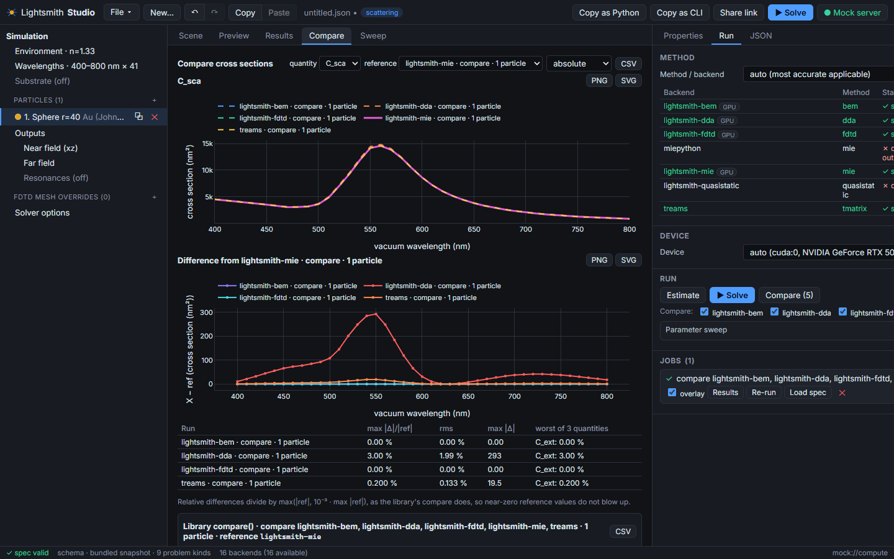

**Sweep** runs one solve per value of one number: any number in the spec (a radius, a position, the medium
index, a layer thickness…) or a numeric option of the chosen method (`options.dda.dipoles_per_diameter`,
`options.fdtd.spacing_nm`…). The Sweep tab reduces each run's curve to a number (peak, its position, minimum,
mean, value at x) and plots it against the parameter, beside the overlaid curves.

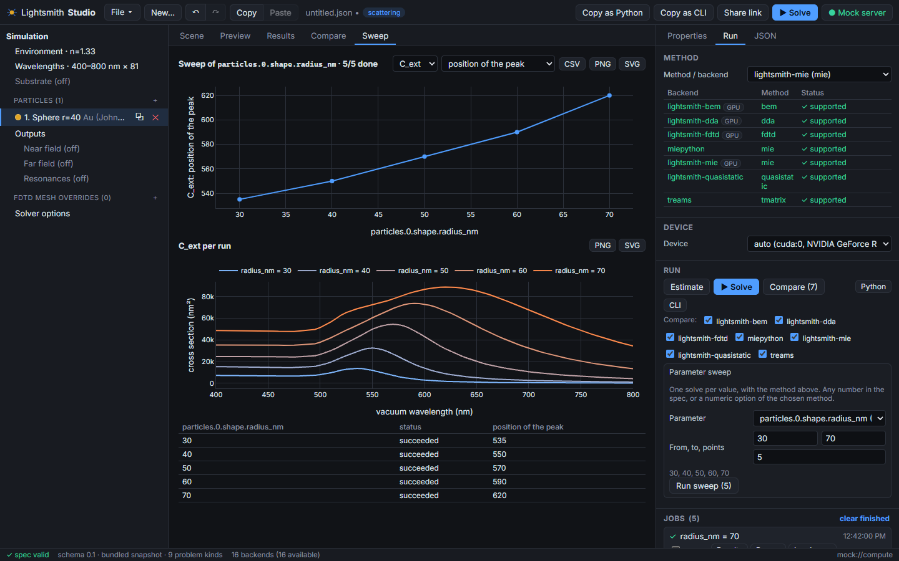

## FDTD set-up

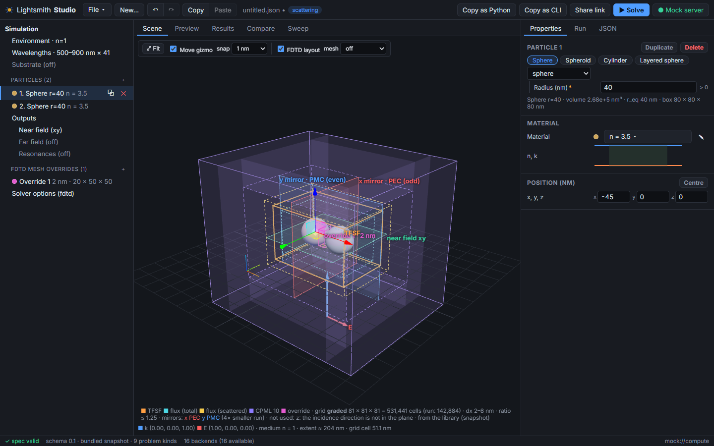

For scattering and emission problems the 3D view draws the FDTD simulation objects, the way a commercial FDTD
CAD tool does, but without computing any of them itself.

- **Objects from the spec**, editable in place:
  - mesh-override boxes (`options.fdtd.mesh_override`), listed in the object tree, moved with the gizmo like
    particles, edited with the generated form of the library's `MeshOverride` model. The form shows cell
    counts and the region the library actually refines;
  - the Gaussian beam: focus, waist ring, axis, and the paraxial 1/e² envelope in the E and H planes. The
    environment editor switches plane wave ↔ Gaussian beam;
  - the emission dipole and its moment, moved with the gizmo.
- **Objects from the library's layout**, shown with the **FDTD layout** toggle (on when the spec has FDTD
  options, the method is FDTD, or only FDTD can run it):
  - TFSF box, total-field and scattered-field flux boxes (the radiated-power box for emission);
  - CPML slabs and thickness;
  - regions refined by `grid: "auto"`;
  - the PEC/PMC mirror planes `symmetry: "auto"` picks, with the run's size reduction and why other planes
    were not used;
  - the legend: grid kind, shape, cells (and cells after halving), cell sizes, grading ratio, and the
    library's refusal when it would not run the spec (for example a graded grid with a Gaussian beam).
- **Mesh preview.** *mesh* picks an xy, xz or yz slice and its position, and draws the library's Yee node
  planes on it, bright where cells are fine. *⟂ view* looks along the slice. Particles turn translucent so the
  grid shows through.

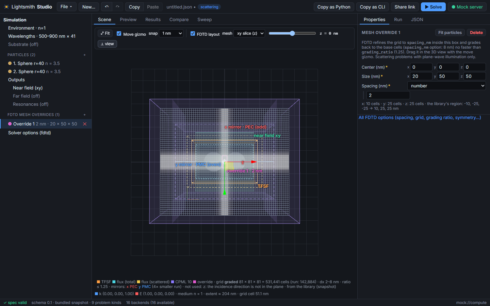

Where the layout comes from (`src/state/layout.ts`):
1. the compute server's `POST /v1/layout`, which Studio proposes to the library (see API_ASSUMPTIONS.md,
   "Proposed: FDTD layout");
2. in development, the Vite dev server's **library bridge**: it runs `scripts/solver_layout.py` against
   `../lightsmith` (needs `uv`; off with `STUDIO_LIBRARY_BRIDGE=0`). That script is the reference
   implementation of the proposal, built on the library's own planning code;
3. the server's `POST /v1/estimate`, which gives the mirror planes only;
4. in the mock, the snapshot of the FDTD templates as shipped.

While a new layout is on its way, the last one stays on screen, marked "before your last edit". A spec the
library would refuse is still drawn, with its reason: below, a Gaussian beam with a mesh override and
`symmetry: "auto"` (graded grids take plane waves only, and beams run without mirror planes), laid out
through the library bridge (`e2e/fdtd-library.spec.ts`).

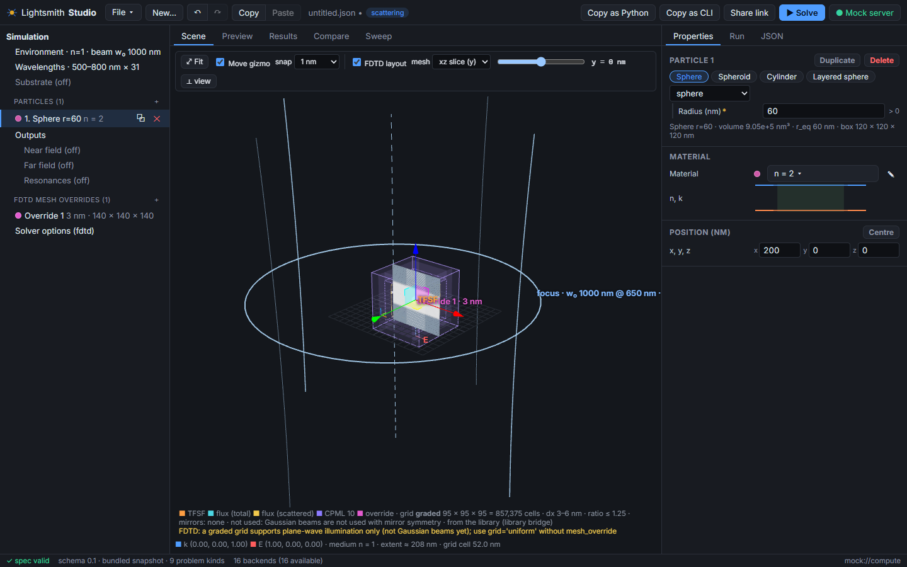

| | |
|---|---|
| 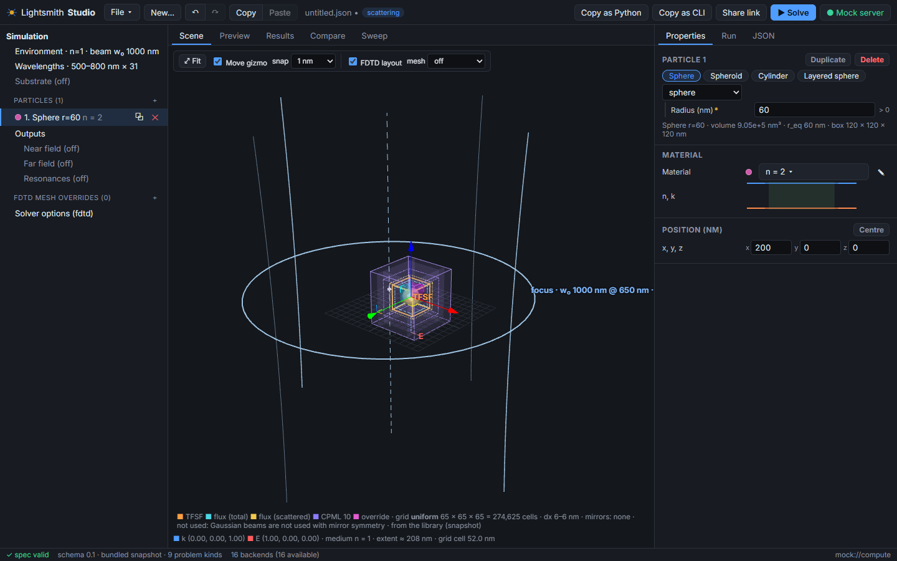 | 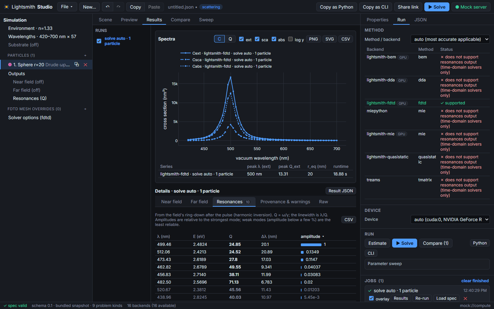 |
| A focused beam: focus, waist and envelope; the legend says why the run uses no mirror planes. | The ring-down of a plasmonic sphere: resonance wavelengths, Q, linewidths, amplitudes. |

## Run it (web, development)

```bash
cd lightsmith-studio
npm install
npm run dev            # http://localhost:5173
```

On first start Studio looks for a compute server at `http://localhost:8200`. If none answers, it
uses the **built-in mock server** and says so in the status bar. In the mock:
- Scattering is computed in the browser: exact Mie for one sphere (checked against the library to
  <0.5 %), quasi-static otherwise.
- Every other kind answers with the library's solved example for that kind. The result carries a
  warning saying it is not a solution of your spec.
- The FDTD templates, unedited, get the library's own FDTD solution and layout from the snapshot. Gaussian
  beams and resonances of any other spec need a compute server.

**Against a real local server:**

```bash
cd ../lightsmith-cloud
uv sync --extra gpu
uv run lightsmith-server
```

Then choose **Server settings → Local server**. The status bar should say "live from server".
`http://localhost:5173` and the Tauri origins are allowed by default. For other origins, use
`LIGHTSMITH_CORS_ORIGINS`.

## Docker (web mode, hosted)

```bash
cd lightsmith-studio
docker build -t lightsmith-studio .
docker run --rm -p 8080:8080 \
  -e STUDIO_COMPUTE_URL=https://compute.example.org \
  -e STUDIO_MATERIALS_URL=https://materials.example.org \
  -e STUDIO_COMMUNITY_URL=https://community.example.org \
  lightsmith-studio
```

The image is built in two stages:
1. `node:22.12.0-alpine3.21` builds the static app.
2. `nginxinc/nginx-unprivileged:1.27.3-alpine3.20` serves it as uid 101 on port 8080.

The image:
- has a `HEALTHCHECK` against `/healthz`;
- is about 55 MB;
- writes `/config.js` at container start from these variables, so one image serves any deployment:

| Variable | Meaning |
|---|---|
| `STUDIO_COMPUTE_URL` | hosted compute base URL; empty = same origin as Studio |
| `STUDIO_MATERIALS_URL` | materials-db base URL; empty = bundled library only |
| `STUDIO_DEFAULT_SERVER` | `hosted` (default when a compute URL is set), `local` or `mock` |
| `STUDIO_LOCAL_COMPUTE_URL` | default `http://localhost:8200` |
| `STUDIO_AUTH_MODE` | `none`, `oidc` or `community`; inferred from the variables below |
| `STUDIO_OIDC_ISSUER`, `STUDIO_OIDC_CLIENT_ID`, `STUDIO_OIDC_SCOPE`, `STUDIO_OIDC_AUDIENCE` | standard OIDC sign-in |
| `STUDIO_COMMUNITY_URL` | Community app, for the token handoff sign-in |
| `STUDIO_FRAME_ANCESTORS` | CSP `frame-ancestors`: who may embed Studio; default `'self'` |

nginx serves:
- the single-page app, with `/index.html` as the fallback;
- `/assets/*` as immutable;
- `config.js` with `no-store`;
- a CSP, `nosniff` and a referrer policy.

For a plain static host, edit `dist/config.js` by hand. Build-time defaults are also available as
Vite variables: `VITE_COMPUTE_URL`, `VITE_MATERIALS_URL`, `VITE_DEFAULT_SERVER`,
`VITE_OIDC_ISSUER`/`VITE_OIDC_CLIENT_ID`/`VITE_OIDC_SCOPE`, and `VITE_COMMUNITY_URL`.

## Signing in (hosted mode)

Studio keeps no user database. In hosted mode it gets a bearer token for the compute service from
the user's **Lightsmith Community** account, in one of two ways:

- **`community`: token handoff.** Studio redirects to
  `{COMMUNITY_URL}/studio/connect?return_to=<studio url>&state=<nonce>`. The Community app signs the
  user in and redirects back to
  `<return_to>#access_token=<compute JWT>&token_type=Bearer&expires_in=<s>&state=<nonce>`.
  > **The Community app does not have this endpoint yet.** The contract is in
  > API_ASSUMPTIONS.md and the shared notes.
- **`oidc`.** Standard Authorization Code flow with PKCE. Use it when the Community app (or the
  deployment's identity provider) acts as an OpenID provider. The IdP must allow Studio's URL as a
  redirect URI and allow CORS on discovery and on the token endpoint.

The token is kept in `sessionStorage`, per tab. The toolbar shows the signed-in name and offers
sign-out. Server settings also accept an API key (`osk_…`) or a pasted access token, for the
desktop app or for scripts.

## Desktop app (Tauri)

The same web build in a native window. It adds:
- native file dialogs with real paths;
- native export dialogs;
- the `lightsmith-studio://` URL scheme, forwarded to the running window.

Prerequisites, which Studio does not install:
- Rust (rustup);
- **Windows**: the MSVC C++ build tools and WebView2;
- **macOS**: the Xcode command-line tools;
- **Linux**: `libwebkit2gtk-4.1-dev build-essential libssl-dev libayatana-appindicator3-dev librsvg2-dev`.

See https://v2.tauri.app/start/prerequisites/.

```bash
npm run tauri dev
npm run tauri build                          # installers in src-tauri/target/release/bundle/
npm run tauri build -- --debug --no-bundle   # quick local exe
```

On first launch the app registers the `lightsmith-studio://` scheme for the current user.

## Scripting

```js
studio.getSpec(); studio.apply([{ op: "replace", path: ["medium_index"], value: 1.5 }])
studio.undo(); studio.redo(); studio.validate()
studio.setRun({ method: "dda", device: "gpu" }); await studio.estimate()
const { job, result } = await studio.solve(); await studio.compare({ methods: ["mie", "dda"] })
studio.python(); studio.cli("solve", "bash"); studio.onChange((spec, ops) => console.log(ops))
```

Embedding pages can `postMessage({studio: "getSpec"|"setSpec"|"apply"|"validate", id, ...})`.

## Parity guarantee

- **Generated forms.** `src/schema/SchemaForm.tsx` generates an editor for any node pydantic
  emits. Hand-made editors (materials, presets, scenes) are layered on top and never replace the
  field set.
- **Parity test.** `src/test/parity.test.tsx` walks the schema of **every problem kind**. It fails
  if:
  - any field gets the "unsupported" editor;
  - any property of any definition renders no editor.

  It also renders every backend's options schema, and a negative control proves the test can fail.
  To run it against a live server:

  ```bash
  STUDIO_SCHEMA_URL="http://localhost:8200/v1/schema" npm test
  ```
- **Templates.** `src/test/kinds.test.ts` checks that every kind's template validates against the
  schema, and that every solved example's result kind has a viewer.
- **Snapshot.** `npm run sync:library` refreshes the library snapshot: schema, backends with options
  schemas, and bundled n/k data. `uv run --project ../lightsmith python scripts/make_fixtures.py`
  re-solves the per-kind examples, and lays out and solves the FDTD templates
  (`src/generated/fdtd_templates.json`, `fixtures/fdtd/`; on the GPU when there is one). It is slow: RCWA
  takes minutes. `make_fixtures.py fdtd layouts` redoes only the FDTD templates and the layout snapshots of
  every example for every backend (`src/generated/layouts.json`), which take seconds.

## Tests

```bash
npm test                                   # Vitest: logic, parity, kinds, FDTD and solver-layout snapshots, curves, sweeps, auth, config
npm run test:e2e                           # Playwright, against the mock: scattering flows, FDTD set-up, every solver's preview, compare, sweeps, every problem kind
STUDIO_LIBRARY_BRIDGE=1 npx playwright test fdtd-library   # layouts from ../lightsmith through the dev-server bridge
STUDIO_COMPUTE_URL=http://localhost:8200 npx playwright test real-server   # against a live compute server
```

Screenshots from the e2e runs are in `docs/screenshots/`.

## Layout

```
src/config/      brand.ts (names), runtime.ts (deployment config)
src/schema/      schema helpers, generated form, validation
src/state/       spec store (undo/redo, ops), connection, jobs, kinds, templates, actions, layouts (solver previews), sweeps
src/api/         compute + materials clients, in-browser mock server
src/components/  viewport (3D), fdtd/ (FDTD objects in 3D), kinds/ (2D/stack/netlist scenes), viewers/ (result kinds), Preview, CompareView, Sweep, panels, dialogs
src/lib/         auth (OIDC / Community), codegen, deep links, files, CSV, scripting, curves (every result kind as curves)
src/generated/   library snapshot, solved examples, FDTD templates, every example's solver layouts
scripts/         sync_library.py, make_fixtures.py, solver_layout.py (what each backend will discretise for a spec)
docker/          nginx template, runtime-config entrypoint
src-tauri/       desktop shell
e2e/             Playwright flows
```

See [API_ASSUMPTIONS.md](API_ASSUMPTIONS.md) for every endpoint Studio relies on.

## Licence

MIT, like the rest of Lightsmith. The bundled material data are CC0 (refractiveindex.info); the
picker shows each dataset's citation.
